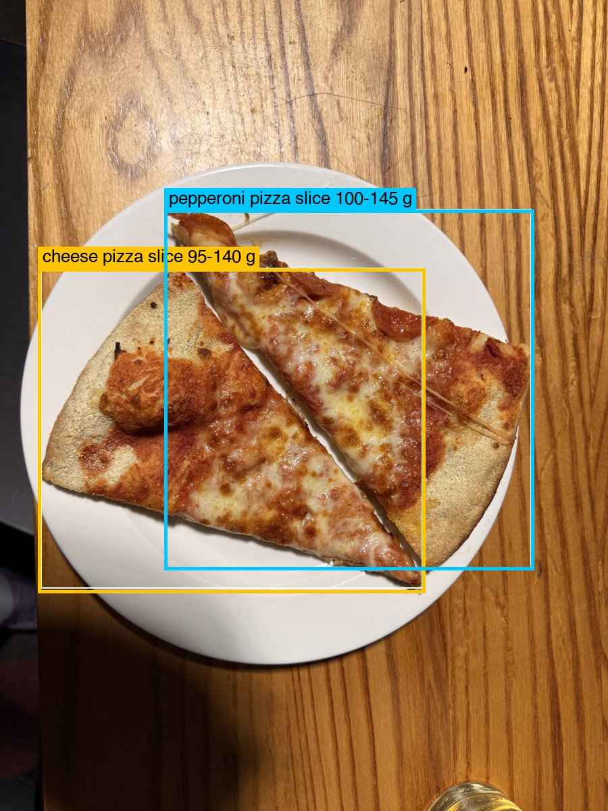
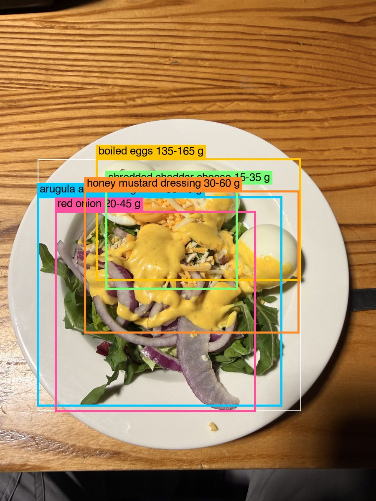

# Gemini benchmark: meal photo → foods → grams

HackUMass XIV, 2026-11-14. 284 Gemini calls: 275 sweep runs (5 real meal photos × 19 configurations × 3 repeats; `xhigh` ran only one repeat) plus 9 calls in one run of the question → answer loop. Later that day, 54 more calls in phase d checked prompt changes for range width (see [Range width](#range-width)), and 75 more checked photos that aren't a meal (phases n and d, see [Photos that aren't a meal](#photos-that-arent-a-meal)). Every call went through the production pipeline: `vision.py` prompt and schema → USDA lookup → totals, same as `mealscholar analyze --no-log`.

Raw data: `bench/results/runs.jsonl`. All tables: `bench/results/summary.md`. Harness: `bench/` (see [Rerun](#rerun)).

## TL;DR

- **Keep `gemini-4-hydrogen` with `low` thinking and the default media resolution.** It takes 5.9 s per photo (median) and costs $0.0097 per photo on paid pricing; Hydrogen is free on the free tier. Every portion estimate landed inside the reference range, recall was 97%, and every drink and salad run asked a useful clarifying question.
- `medium`/`high` thinking fix the hardest case (ginger ale identified 67% → 100% of runs) but add 2.5–3 s and 45–57% more cost. At `low`, the clarifying question already covers that case: on every ginger-ale run it asked what the drink was. So `low` plus the question is the better experience.
- **Budget fallback: `gemini-3.6-flash` with `minimal` thinking.** 4.1 s and $0.0022 per photo (4.4× cheaper). Same recall and box quality, but it called the ginger ale iced tea in every run.
- **Avoid:**
  - `xhigh` thinking: 99 s median, $0.14 per photo, 18K thinking tokens, no accuracy gain.
  - `gemini-4-argon`: best at naming foods, but latency is unpredictable (16 s median, 59–61 s p90, one call took 228 s).
  - `gemini-3.5-flash-lite`: misses components, merges the far-away salad into one "egg salad" item, and calls pink lemonade a cocktail.
- **The largest error source is the USDA lookup, not Gemini.** 35% of runs fall outside the reference calorie range, and half of those come from matches to powders or concentrates:
  - pink lemonade → frozen concentrate at 192 kcal/100 g (4× too high) in 37 of 55 runs;
  - sweet iced tea → instant tea powder at 401 kcal/100 g.
  - Pepperoni pizza was named correctly in 54 of 55 runs but matched to a pepperoni pizza only once.
  - **Both lookup bugs are fixed on this branch** (see [Lookup fixes](#lookup-fixes)). Replayed on the same Gemini output: kcal in band 179 → 230 of 275 runs, runs with a powder/concentrate match 54 → 4 (the 4 are prepared forms or explicitly requested), pepperoni 1/54 → 50/54. Hydrogen `low` goes from 73% to 93% kcal in band.
- **Gemini's bounding boxes are accurate** (IoU 0.95–0.98 against hand-drawn boxes on every model). Drawing them on the photo costs nothing extra and makes a strong demo moment.
- **Meal ranges were wider than they need to be** (#54). Every food's low and every food's high were added up, as if all the foods on a plate were off in the same direction at once. They now combine as partly correlated errors. On Hydrogen `low` photos with several foods, the kcal range shrinks from 51% to 38% of likely, and every reference amount is still inside. Telling Gemini that low and high are the 10th and 90th percentile changed nothing measurable.
- **Photos that aren't a meal are no longer logged** (#49). Plastic display food used to be logged as 6–7 dishes at 1,700–1,960 kcal, and a finished plate as its scraps. A prompt rule fixed both: 24/24 non-meal runs are now not logged (18/24 before), and no real meal photo lost its foods.

## What was tested

| Photo | Contents (confirmed by the person who ate it) | What makes it hard |
|---|---|---|
| `IMG_0579` | 1 cheese and 1 pepperoni slice, thin crust, top-down | Two similar items; a glass rim at the frame edge |
| `IMG_0580` | Ginger ale with ice, top-down | An amber drink that looks like iced tea, apple juice, or whiskey; part of the pizza plate is at the edge |
| `IMG_0581` | Pink lemonade with ice, from an angle | Identifiable by color only; a flyer in the background |
| `IMG_0582` | Arugula, red onion, 3 whole hard-boiled eggs, shredded cheddar, honey mustard | 5 components; the dressing carries most of the calories; whole eggs vs halves is ambiguous |
| `IMG_0583` | The same salad, shot from across the table | Small in the frame; a person, a napkin dispenser, and a glass at the edge |

All photos: iPhone 16 Pro, Nov 13 23:45–23:51, UMass Amherst dining hall. The pipeline resizes each photo to a 1536 px JPEG and strips EXIF before sending it.

**Configurations**
- **Phase A:** 6 models × their thinking levels, at the default media resolution.
- **Phase B:** media resolution `low` / `medium` / `ultra_high` for Hydrogen `low` and Flash-Lite `minimal`.
- 3 repeats each. `xhigh` ran 1 repeat and was stopped at about 100 s per call.
- **Phase C:** the clarifying question → answer → recompute loop, Hydrogen `low`, 1 repeat.
- **Phase D:** phase C rerun after a prompt change, Hydrogen `low`, 3 repeats.
- **Phase N:** 8 photos that are not a meal (`bench/nonfood/`), Hydrogen `low`, 3 repeats, analyze only.
- Models: `gemini-4-argon`, `gemini-4-hydrogen`, `gemini-3.8-flash`, `gemini-3.6-flash`, `gemini-3.5-flash-lite`, `gemini-3.1-flash-lite`.

**Scoring** (labels and regexes in `bench/ground_truth.py`)

Gemini's own outputs (foods, grams, boxes, question) are scored separately from what the app displays (kcal), because kcal also depends on the USDA match.

- **Recall:** the share of labeled components found in the output (pizza and pepperoni; the drink; greens, onion, egg, cheese, dressing).
- **Identity:** judged on `fdc_query`, the string that picks the USDA food. "Iced amber beverage" sent with `Soft drink, ginger ale` counts as right; "ginger ale or iced tea" sent with `Tea, iced` counts as wrong.
- **Grams in band:** whether the total grams of labeled items fall inside a reference range. **Nothing was weighed.** The ranges are visual estimates anchored on USDA FNDDS portion weights: 86–128 g per large or extra-large pizza slice, 50 g per egg, 15.6 g per tablespoon of dressing, 23 g per fl oz of soda with ice. They measure plausibility, not precision.
- **kcal in band:** pipeline kcal for the labeled items, compared with the reference range.
- **Box IoU:** overlap with hand-drawn boxes for the pizza slices, the glasses, and the extent of the salad.
- **Useful question:** asks about the drink's identity or sugar (drink photos) or the dressing (salad photos).

## Results

Phase A, default media resolution. Prices are paid-tier standard rates from [ai.google.dev pricing](https://ai.google.dev/gemini-api/docs/pricing) on 2026-11-14. The "Lemonade" column counts any lemonade `fdc_query`.

| Config | p50 s | p90 s | $/photo | Recall | Ginger ale | Lemonade | Honey mustard | Grams in band | Useful question | Box IoU | kcal in band |
|---|---|---|---|---|---|---|---|---|---|---|---|
| `4-argon` low | 16.8 | 61.0 | 0.0087 | 100% | 100% | 100% | 100% | 100% | 100% | 0.97 | 100% |
| `4-argon` medium | 16.2 | 58.9 | 0.0090 | 99% | 67% | 100% | 100% | 93% | 100% | 0.98 | 93% |
| **`4-hydrogen` low** | **5.9** | **9.3** | **0.0097** | **97%** | **67%** | **100%** | **100%** | **100%** | **100%** | **0.96** | **73%** |
| `4-hydrogen` medium | 8.4 | 12.9 | 0.0141 | 97% | 100% | 100% | 100% | 100% | 83% | 0.97 | 80% |
| `4-hydrogen` high | 8.7 | 16.9 | 0.0152 | 100% | 100% | 100% | 100% | 100% | 75% | 0.97 | 80% |
| `4-hydrogen` xhigh (n=5) | 99.1 | 142.6 | 0.1438 | 100% | 100% | 100% | 100% | 100% | 75% | 0.97 | 100% |
| `3.8-flash` low | 7.0 | 10.1 | 0.0027 | 100% | 0% | 100% | 100% | 80% | 100% | 0.97 | 60% |
| `3.8-flash` medium | 11.8 | 16.3 | 0.0051 | 99% | 0% | 100% | 100% | 73% | 75% | 0.95 | 40% |
| `3.6-flash` minimal | 4.1 | 5.7 | 0.0022 | 100% | 0% | 100% | 100% | 93% | 100% | 0.97 | 67% |
| `3.6-flash` medium | 9.7 | 13.0 | 0.0054 | 100% | 0% | 100% | 100% | 73% | 75% | 0.96 | 47% |
| `3.5-flash-lite` minimal | 3.0 | 4.4 | 0.0013 | 83% | 0% | 0% | 50% | 87% | 100% | 0.97 | 40% |
| `3.5-flash-lite` low | 3.1 | 4.2 | 0.0012 | 81% | 0% | 100% | 50% | 87% | 75% | 0.97 | 47% |
| `3.1-flash-lite` minimal | 3.3 | 6.1 | 0.0009 | 100% | 0% | 33% | 0% | 60% | 100% | 0.95 | 40% |

Phase B, media resolution. Default is equivalent to `high` (about 1,064 image tokens on Gemini 3 and 4).

| Config | Image tokens | p50 s | $/photo | Recall | Ginger ale | Lemonade | Honey mustard | Grams in band | Grams CV | kcal in band |
|---|---|---|---|---|---|---|---|---|---|---|
| `4-hydrogen` low · res low | 266 | 5.5 | 0.0090 | 100% | 67% | 67% | 100% | 87% | 9% | 73% |
| `4-hydrogen` low · res medium | 540 | 6.3 | 0.0101 | 95% | 33% | 100% | 100% | 80% | 3% | 67% |
| `4-hydrogen` low · default | 1064 | 5.9 | 0.0097 | 97% | 67% | 100% | 100% | 100% | 7% | 73% |
| `4-hydrogen` low · res ultra_high | 2160 | 5.9 | 0.0114 | 97% | 67% | 100% | 100% | 100% | 3% | 80% |
| `3.5-flash-lite` minimal · res low | 266 | 3.0 | 0.0010 | 81% | 0% | 100% | 50% | 73% | 23% | 60% |
| `3.5-flash-lite` minimal · res medium | 540 | 3.2 | 0.0011 | 79% | 0% | 67% | 17% | 80% | 11% | 47% |
| `3.5-flash-lite` minimal · default | 1064 | 3.0 | 0.0013 | 83% | 0% | 0% | 50% | 87% | 5% | 40% |
| `3.5-flash-lite` minimal · res ultra_high | 2160 | 3.4 | 0.0017 | 87% | 0% | 100% | 83% | 87% | 6% | 67% |

Hydrogen `low`, default resolution, first repeat (white boxes are hand-drawn references):





More overlays: `bench/results/overlays/gemini-4-hydrogen_low_default/` and, for comparison, `bench/results/overlays/gemini-3.5-flash-lite_minimal_default/`. The `IMG_0583` overlays are not committed because that photo shows a person; on it, Flash-Lite collapsed the whole salad into "egg salad with greens and dressing".

## Findings

1. **`low` is the sweet spot for thinking.** On Hydrogen:

   | Thinking | Thinking tokens | p50 s | $/photo |
   |---|---|---|---|
   | `low` | 435 | 5.9 | 0.0097 |
   | `medium` | 1,052 | 8.4 | 0.0141 |
   | `high` | 1,195 | 8.7 | 0.0152 |
   | `xhigh` | 18,394 | 99.1 | 0.1438 |

   The only accuracy gain above `low` is the ginger ale. `medium` and higher also spent the clarifying question on the edge glass in `IMG_0583` more often than on the dressing, so useful questions dropped from 100% to 75–83%. On the 3.x Flash models, `medium` was worse than `minimal`/`low`: fewer portions in band and fewer useful questions.
2. **Keep the default media resolution.** On Hydrogen, `low` resolution saves 798 input tokens but only 7% of the cost, because thinking and output tokens dominate the bill. It also drops grams-in-band from 100% to 87%. `ultra_high` adds 18% to the cost with no gain beyond noise. Tokens are capped per image, so sending more than the current 1536 px only wastes upload time. Flash-Lite does gain from `ultra_high` (honey mustard 50% → 83%) but still trails 3.6 Flash `minimal` at the default resolution.
3. **Drink identity is the one hard case.** No 3.x model ever sent `Soft drink, ginger ale`. They sent `Tea, iced …` in almost every run; 3.6 Flash once hedged with "cola, or iced tea or alcoholic beverage", and 3.5 Flash-Lite also guessed whiskey and cola. Gemini 4 got it in 67–100% of runs. Pink lemonade was easy for everything except 3.5 Flash-Lite at the default resolution ("cocktail") and 3.1 Flash-Lite ("grapefruit juice", "fruit juice drink").
4. **No invented foods and no broken JSON.** Across 275 sweep runs there were 0 unexpected items: the person, the flyer, and the napkin dispenser were never logged. All 275 responses parsed against the schema. Asking for `minimal` thinking on `gemini-4-hydrogen` returns HTTP 400 ("Thinking level THINKING_LEVEL_MINIMAL is not supported"), which the README listed as a valid option. The README is now fixed.
5. **Items at the frame edge get logged, which double-counts across photos.**
   - The partial pizza plate in the drink photo was logged in **55 of 55** runs. On Hydrogen `low` it added 170–210 kcal to a drink.
   - The glass at the edge of `IMG_0583` was logged in 39 of 55 runs.
   - In 22 of 55 runs on `IMG_0583`, the clarifying question asked about that glass instead of the dressing.
   - The tiny glass rim in `IMG_0579` was ignored in 55 of 55 runs.
6. **The USDA lookup causes most calorie errors.** Of the 96 runs outside the kcal range:
   - 50 had a powder or concentrate match;
   - 25 had grams outside the range;
   - 21 had the wrong food identity or density.

   Recurring failures:

   | Gemini `fdc_query` | USDA match | kcal/100 g: matched vs right | Frequency | Effect |
   |---|---|---|---|---|
   | `Lemonade, pink` | Lemonade, frozen concentrate, pink | 192 vs 25–46 | 37/55 pink-lemonade runs | 240 g shows 461 kcal instead of about 110 |
   | `Tea, iced, sweetened` (and variants) | Tea, iced, instant, black, pre-sweetened, **dry** (or lemon tea powder) | 401 vs about 32 | 17/110 runs on the two photos with an amber drink | 240 g shows 962 kcal |
   | `Pizza, pepperoni, …` | Pizza, cheese, … | 266 vs 282 | pepperoni matched 1/55 | Wrong food name on screen; small kcal error |
   | `Salad, vegetable, with cheese and dressing` | Salad dressing, NFS | 430 vs about 100 | 5 | The whole salad is priced as dressing |
   | `Salad, arugula and red onion, raw` | Carrots, raw, salad | 212 vs 25–40 | 1 | |
   | `Salad, arugula` / `green, with red onion, no dressing` | Cobb salad, no dressing | 93 vs about 25 | 2 | |
   | `Alcoholic beverage, whiskey` | Alcoholic beverage, whiskey sour | 149 vs 250 | 3 | |

   Causes, in `nutrition.py`:
   - **Concentrates and powders:** `_Scorer` rewards the matched word "pink" and nothing penalizes "concentrate", "powder", or "dry".
   - **Pepperoni:** FNDDS names the food `Pizza with pepperoni, …` with no comma. The head-of-query rule gives the "name starts with the main food" bonus to `Pizza, cheese, …` instead.

   With correct matches, Hydrogen `low` lands in range on pizza (625–692 kcal vs 500–850) and both salads (466–573 vs 350–640). The first two causes are fixed on this branch; see [Lookup fixes](#lookup-fixes).
7. **The question → answer loop works, with one bug.** Phase C, Hydrogen `low`:

   | Photo | Gemini asked | kcal before | kcal after the answer |
   |---|---|---|---|
   | `IMG_0581` | What kind of drink is this (e.g. pink lemonade, juice, or cocktail)? | 461 (346–576) | **110 (83–138)** |
   | `IMG_0580` | What is the drink in the glass (e.g., unsweetened iced tea, ginger ale, or alcohol)? | 188 (108–295) | 288 (191–415)\* |
   | `IMG_0582` | What type of dressing is on the salad? | 549 (396–702) | 572 (466–702) |
   | `IMG_0583` | What is in the glass on the right (…)? | 1,539 (1,091–2,003) | 785 (555–1,055)† |
   | `IMG_0579` | (none asked) | 625 (492–758) | — |

   - Answering "regular pink lemonade" changed the query to `Lemonade, pink, regular, ready-to-drink`, which also escaped the concentrate match.
   - \*The `IMG_0580` total still includes 70 g of the edge pizza (186 kcal); the ginger ale alone is 300 g ≈ 102 kcal.
   - †Before the answer, the edge glass was matched to instant tea powder (962 kcal). The scripted answer described the dressing instead of the glass; in response, refine dropped the drink and listed honey mustard twice (40 g + 45 g).
   - The refine call is text-only and takes 2.9–5.3 s.
8. **Other observations.**
   - Gemini 4 models bill about 870 more input tokens than 3.x for the same prompt and schema (2,394 vs 1,523), worth about $0.0013 per call.
   - Argon's latency spikes come from capacity, not thinking: it used 0–236 thinking tokens per call, and one call took 228 s.
   - Local work (image decode, resize, USDA lookup) adds 0.21 s at p50.
   - About 43 of 216 questions joined two asks ("whole eggs or halves, and what dressing?"), despite the prompt asking for "at most one short question". This count comes from a regex.
   - The egg question was right to ask: most models estimated 3 whole eggs (150 g) and asked "whole or halves?". The first human label said halves; the person who ate the salad confirmed whole eggs.

## Lookup fixes

Branch `gemini-benchmark`, `_Scorer` in `src/mealscholar/nutrition.py`:

- **Processed forms.** A candidate containing `concentrate`, `powder`, `dry`, `dried`, `instant`, `dehydrated`, `condensed` or `unprepared` loses 5 points, unless the query asked for that word or the candidate is the prepared form ("…, prepared with water"). Five points outweigh one matched descriptor plus a couple of extra words, which is exactly how "Lemonade, frozen concentrate, pink" used to beat "Lemonade, fruit juice drink".
- **Pepperoni.** A description named `<main food> with …` now counts as starting with the main food, so `Pizza with pepperoni, …` competes with `Pizza, cheese, …` and wins on the word "pepperoni".
  - The first version accepted any word after the main food. The replay showed it sent 20 different salad queries to salad dressings (mostly "Salad dressing, NFS", 430 kcal/100 g), "Onion, raw" to "Onion dip", and "Water, municipal" to "Water convolvulus".
  - Limiting the rule to "with" removed all three. `test_another_food_starting_with_the_main_food_is_not_it` guards it.

Measured by redoing the USDA lookup on the 275 recorded Gemini outputs with `bench/report.py --rematch`. On unchanged code the replay reproduces the recorded tables exactly, so the difference below comes from the fix alone.

| All 275 runs, same Gemini output | Before | After |
|---|---|---|
| Runs with kcal in the reference range | 179 (65%) | 230 (84%) |
| Runs outside the range | 96 | 45 (−53%) |
| Runs with a powder/concentrate match | 54 | 4 (3 "…prepared with water", 1 query that asked for concentrate) |
| Pepperoni slice matched to a pepperoni pizza | 1/54 | 50/54 |

| Config | kcal in band, before → after | Median kcal error, before → after |
|---|---|---|
| `4-hydrogen` low (default) | 73% → 93% | 15% → 10% |
| `4-hydrogen` medium | 80% → 100% | 10% → 6% |
| `3.6-flash` minimal (budget) | 67% → 100% | 18% → 10% |
| `3.5-flash-lite` minimal | 40% → 60% | 43% → 32% |
| `4-argon` low | 100% → 100% | 6% → 6% |

**Every changed match** (diff of `bench/results/summary.md` and `summary-rematched.md`):
- `Lemonade, pink` ×32: frozen concentrate (192 kcal/100 g) → Lemonade, fruit juice drink (46).
- Sweet iced tea queries ×17: instant tea powder (401) → brewed or ready-to-drink sweet tea (27–32).
- `Pizza, pepperoni, …` and `Pizza, with pepperoni, …` ×50: cheese pizza (266) → pepperoni pizza (274–296).
- `Pizza, with meat, …` ×1: cheese pizza → pizza with meat and vegetables (241).
- `Fruit punch drink, or lemonade, pink` ×1: punch concentrate (162) → canned punch (47).
- `Lemonade, pink, prepared` ×1: frozen concentrate (192) → lemonade powder prepared with water (14). Still wrong, now in the other direction.

**Still wrong after the fix:**
- ~~`Pizza, cheese and pepperoni, thin crust` (3 runs) ties with "Pizza, extra cheese, thin crust" and loses the tiebreak (268 vs 274 kcal/100 g).~~ Fixed in #108, below.
- ~~`Tea, iced, un-sweetened` splits into "un" + "sweetened" and lands on pre-sweetened tea (32 vs 1).~~ Fixed in #108.
- 3.x models still call the ginger ale iced tea. The calories now land in range only because brewed sweet tea (32) and ginger ale (34) have about the same density.
- ~~A salad sent as one item (`Salad, vegetable, with cheese and dressing`) still matches "Salad dressing, NFS".~~ Fixed in #108: it now matches a lettuce salad, so the dressing inside it isn't counted. Only splitting the salad in the prompt fixes that (fix 5 below).

**Left-out words, green salads and sweet tea (#108).** Four changes to `_Scorer` and its word handling:
- **Left-out words.** In a descriptor, the words after `no`, `without` or `excluding` (up to the next comma) are left out: they are no longer search or ranking words, a candidate that has one loses 3 points, and a candidate that leaves out the same thing ("…, no dressing") counts it as a match. "with or without" leaves nothing out. Before, "without dressing" matched "Salad dressing, NFS" on the word dressing.
- **Green salads.** FNDDS has no "Salad, …" entries. It files a plain green salad as "Lettuce, salad with …" or "Mixed salad greens", so for a query whose main food is `Salad` those count as starting with the main food. Before, every candidate was another salad: carrot, gelatin, tuna, Cobb, or a dressing.
- **Stems.** `un-sweetened` is joined to `unsweetened`, `sweetened` stems to `sweet`, and `iced` to `ice`.
- **The food's own name.** A query descriptor that a candidate puts before its first comma gets 1 more point. "Pizza with pepperoni, …" names the pepperoni; "Pizza, extra cheese, …" only describes the cheese. Head words don't count, since every candidate has them; counting them sent `Iced tea, sweetened` to "Long Island iced tea".

Replay of the same 275 runs: kcal in band 230 → 231, powder/concentrate matches 4 → 4, pepperoni 50/54 → 53/54. `REMATCH_LIMITS` is raised to match. Every changed match:
- `Salad, …` sent as one item ×22: salad dressing (430 kcal/100 g), carrot salad (212), tuna salad (190), Cobb salad (93) or gelatin salad (61) → lettuce salad (23–91) or mixed salad greens (21). On Hydrogen `low`, `IMG_0583` rep 0 drops from 573 to 458 kcal, because its 60 g "arugula and red onion salad" no longer counts as carrot salad. One 3.5-flash-lite run leaves the band (380 → 142 kcal): its whole salad, dressing included, was in range only because it matched tuna salad.
- `Pizza, cheese and pepperoni, thin crust` ×3: extra-cheese pizza (268) → pepperoni pizza (274), which brings one 3.8-flash run into the band.
- `Tea, iced, un-sweetened` ×1: pre-sweetened (32) → unsweetened (1). `Tea, sweet, brewed, with ice` ×1: ginger tea (1) → pre-sweetened (32), which brings one 3.6-flash run into the band. `Tea, sweet, iced` ×1: bottled (45) → brewed pre-sweetened (32).
- `Lettuce, salad, with assorted vegetables, raw` ×2: plain lettuce → lettuce salad with assorted vegetables (23).

Still wrong: `Tea, sweetened, ready to drink` (1 run) matches "Tea, ginger" (1 kcal/100 g). The ready-to-drink entry is filed under "Beverages, tea, …". Treating "Beverages, X" as X fixed it, but it also sent `Lemonade, pink` ×32 to a concentrate prepared with water (bad matches 4 → 36), so that change isn't kept.

## Range width

Issue #54: meal #7 on the live site showed 945–1,455 kcal, a 510 kcal spread around a likely value of 1,163.

**Adding every low and every high was the main cause.** `compute.add_ranges` added up each food's low and each food's high, which assumes every food on the plate is off in the same direction at once. Now the distances from likely add up as partly correlated errors, `sqrt((1 − c)·Σw² + c·(Σw)²)` with `c = SHARED_ERROR = 0.3`. That's the old sum at c = 1 and independent errors at c = 0. Day totals use the same rule, and a weighed food adds no width.

Sweep runs with several labeled foods (the pizza and both salads), USDA lookup redone with current code:

| Runs | c | kcal range, median % of likely | Reference grams inside the range | Reference kcal inside the range |
|---|---|---|---|---|
| Hydrogen `low` | 1 (before) | 51% | 9/9 | 9/9 |
| Hydrogen `low` | **0.3 (now)** | **38%** | **9/9** | **9/9** |
| Hydrogen `low` | 0 | 30% | 7/9 | 8/9 |
| All 19 configs | 1 (before) | 55% | 130/152 | 131/152 |
| All 19 configs | 0.3 (now) | 42% | 119/152 | 123/152 |
| All 19 configs | 0 | 35% | 101/152 | 115/152 |

- **Why 0.3:** across all configs, coverage falls steadily as c drops, with no clear point to stop, so c is a judgment call. 0.3 keeps every reference inside the range on the production config, and 0 does not. The errors aren't independent, because every food is sized against the same plate.
- **Meal #7:** from the item ranges in the issue, the total becomes 1,010–1,369 kcal, a 359 kcal spread instead of 510. The diary recomputes totals when it reads a meal, so logged meals show the new range too.
- **Photos of one food don't change:** a single food's range is its own. On those photos the width comes from Gemini's item ranges, a median of −29% / +33% of likely for Hydrogen `low`.

**Defining low and high as the 10th and 90th percentile changed nothing measurable.** Phase d reran Hydrogen `low` (5 photos × 3 reps, analyze and answer) with two prompts in the same hour. `0e460f6e` told Gemini that low and high are the 10th and 90th percentile, and to make the range as wide as its uncertainty and no wider. `56e180c6` is the sweep's analysis prompt, so it serves as a control; only its refine prompt changed (below).

| Runs | Item range below / above likely | kcal range, one food | kcal range, several foods | Reference grams inside the range |
|---|---|---|---|---|
| Sweep (night of Nov 13) | −29% / +33% | 56% | 38% | 15/15 |
| Phase d control, sweep's analysis prompt | −30% / +38% | 65% | 39% | 15/15 |
| Phase d, 10th/90th percentile prompt | −32% / +40% | 68% | 40% | 15/15 |

The percentile prompt lands within 3 points of the control. The same prompt, rerun about 10 hours after the sweep, gave one-food ranges 9 points wider, so widths need a same-day control to compare. The percentile wording isn't kept.

**The refine prompt now narrows what the answer pins down.** When the answer gives an amount ("about 12 oz", "about 3 tablespoons"), the refine prompt asks Gemini to narrow the low and high of the items it affects. On the 9 phase d runs with such an answer, those items' ranges went from 73% to 22% of likely (median), and the meal's kcal range shrank to 0.69× its width before the answer. Gemini already narrowed them without the instruction (phase c, 3 runs: 81% → 35%, meal range 0.72×), so the gain is small.

**Omelette lookup.** `Egg, omelet, with cheese, spinach, and tomatoes, cooked in oil` matched "Egg, whole, fried with oil" (192 kcal/100 g). The main-food-first rule only accepted descriptions that start with "Egg," or "Egg with", but FNDDS also joins the main food and its first descriptor: "Egg omelet or scrambled egg, …". The rule now accepts that, so the query matches "Egg omelet or scrambled egg, with cheese, made with oil" (212). The replay is unchanged (230/275, 4, 50/54). On 81 everyday queries, 4 matches changed:
- 2 omelette queries now match an omelette.
- `Chicken, breast, grilled` matched raw chicken breast and now matches "Chicken breast, grilled with sauce, skin eaten".
- `Chicken, nuggets` matched "Chicken, back" and now matches "Chicken nuggets, NFS".

**Still open:** only weighed meals can show whether a narrower range is still honest (see [Limitations](#limitations)).

## Photos that aren't a meal

Phase n runs 8 photos the app must not log (#49). They are committed in `bench/nonfood/`, with sources and licenses in its README, and labeled in `NON_MEALS` in `bench/ground_truth.py`. A run passes when the result has no items, because the app logs only results with items. Hydrogen `low`, 3 repeats per prompt.

| Photo | Prompt on `main` (`56e180c6`) | New rule (`e9181571`) |
|---|---|---|
| Keyboard, houseplant, black frame, clean plate, chalkboard menu, dog food | 18/18 not logged | 18/18 |
| Plastic food replicas in a display case | 0/3: logged as 6–7 dishes, 1,707–1,957 kcal | 3/3 |
| Finished breakfast plate with a few scraps left | 0/3: logged as tomato and beans, 86–105 kcal | 3/3 |

The rule (the last bullet of `SYSTEM_PROMPT`): only real food or drink that is about to be eaten or drunk counts. Food models or replicas, food on display in a shop window or display case, pictures of food (a menu, a screen, a poster), pet food, and a plate eaten down to scraps return `is_food=false`. On the replicas, the old prompt asked "Which of these items from the display case are you eating?" but still counted every dish. When Gemini says a photo isn't a meal, the pipeline now drops its question too; the CLI used to ask it, and answering re-ran Gemini.

**Real meals still count.** Phase d reran the 5 meal photos (analyze and answer, 3 repeats) on the new rule, compared with the phase d control from earlier the same day (`56e180c6`). Every run kept its foods: recall was 100% (95% for the control). The other differences are one run either way, within the noise for 15 runs:
- ginger ale named exactly in 2 of 3 runs (control 3/3; the sweep also had 2/3);
- kcal in band 87% (control 93%);
- useful question 100% (control 92%).

**Not tested:** food on a screen or a poster, a buffet line, and someone else's plate. A photo of a partly eaten meal still counts what is left on the plate.

## Recommendations

### Configuration
- Keep the defaults: `MEALSCHOLAR_MODEL=gemini-4-hydrogen`, `MEALSCHOLAR_THINKING=low`, no `resolution` override.
- For a cheaper or faster demo fallback: `MEALSCHOLAR_MODEL=gemini-3.6-flash MEALSCHOLAR_THINKING=minimal`.

### Code fixes, ranked by measured impact
1. **Done on this branch:** the USDA scorer penalizes processed forms the query did not ask for. Runs with a powder/concentrate match went from 54 to 4, all prepared forms or explicitly requested.
2. **Done on this branch:** `Pizza with X, …` counts as starting with the main food. Pepperoni matched 1/54 → 50/54. With fix 1, 51 of the 96 out-of-range runs are now in range.
3. **Prompt: skip food cut off by the frame edge** unless it is the subject of the photo, and point the question at the main subject. This fixes the drink-photo pizza (55/55) and the `IMG_0583` glass (39/55 logged, 22/55 asked about).
4. **Refine prompt:** "update existing items; never duplicate one". Then add a refine test for the duplicate-dressing case.
5. **Prompt: one question, one sentence** (43/216 were compound). Composite salads should be split into components. Since #108, a salad sent as one item matches a lettuce salad instead of `Salad dressing, NFS`, but its dressing isn't counted.

### What to show for "Best Use of Gemini API"
- **One call, structured output:** foods, gram ranges, cooking method, bounding boxes, a scale reference, and one clarifying question, all from a Pydantic schema. 275/275 responses were valid.
- **The signature moment: Gemini's boxes drawn on the photo**, each labeled with a gram range. IoU against hand-drawn boxes is 0.96; the overlays above are real output.
- **The live question loop:** "What kind of drink is this?" → "pink lemonade" → 461 → 110 kcal on stage.
- **Thinking level and media resolution chosen by measurement:** cite the two tables above.
- **Privacy:** `store=False`, EXIF stripped, coordinates dropped before Gemini sees anything.
- **Next uses of Gemini that fix the measured weaknesses:**
  - Let Gemini choose among the top USDA candidates with structured output, grounding the match (finding 6).
  - Send all photos of one meal in a single multi-image request so edge items are counted once (finding 5).

## Limitations
- 5 photos from one dining hall on one night, 3 repeats. One photo is 20% of a column, so gaps of about 20 points between configurations are within noise.
- Reference grams and kcal are unweighed estimates. Weighing 10 meals on a kitchen scale would turn "in band" into real error bars.
- Latency was measured from one laptop with up to 19 configurations in flight at once (at most 7 on one model). Single requests from a phone were not measured.
- Prices as of 2026-11-14: Argon doubles on 2026-12-01; 3.8/3.6 Flash double on 2027-01-01.

## Rerun

```sh
uv run mealscholar fdc-import                                 # once
uv run --env-file .env python bench/run.py --phase a --phase b   # sweep (resumable; this whole benchmark cost $2.40)
uv run --env-file .env python bench/run.py --phase c --config 'gemini-4-hydrogen|low|default' --reps 1
uv run --env-file .env python bench/run.py --phase d --config 'gemini-4-hydrogen|low|default'   # after a prompt change
uv run --env-file .env python bench/run.py --phase n --config 'gemini-4-hydrogen|low|default'   # photos that aren't a meal
uv run python bench/report.py              # recorded results -> bench/results/summary.md
uv run python bench/report.py --rematch    # redo the USDA lookup with current code -> summary-rematched.md
uv run python bench/report.py --rematch --check   # same, exit 1 if worse than REMATCH_LIMITS (what CI runs)
uv run python bench/report.py --overlays 'gemini-4-hydrogen|low|default'
```

The meal photos are in `test_pictures/` (IMG_0579–IMG_0583, IMG_0587, IMG_2164 and IMG_2165). The committed copies have EXIF and XMP removed, including GPS; the camera originals still have location, so don't commit those. `bench/run.py` reads only `*.jpeg`, so IMG_2164.jpg (omelette, home fries, avocado) and IMG_2165.jpg (ramen and a dark soda) aren't in benchmark runs. `--rematch` needs only the recorded results and the USDA database. The non-meal photos for phase n are committed in `bench/nonfood/` (no GPS tags). To rerun from scratch, delete `bench/results/runs.jsonl`.

The **Lookup regression** workflow (`.github/workflows/lookup-regression.yml`) runs `--rematch --check` on pull requests that touch the lookup (`nutrition.py`, `nutrients.py`, `compute.py`, `pipeline.py`, `schemas.py`), `bench/`, or dependencies. Limits since #108: kcal in band ≥ 231/275, powder/concentrate matches ≤ 4, pepperoni ≥ 53/54. When a lookup change beats them, raise `REMATCH_LIMITS` in `bench/report.py` in the same PR so the gain is kept.
