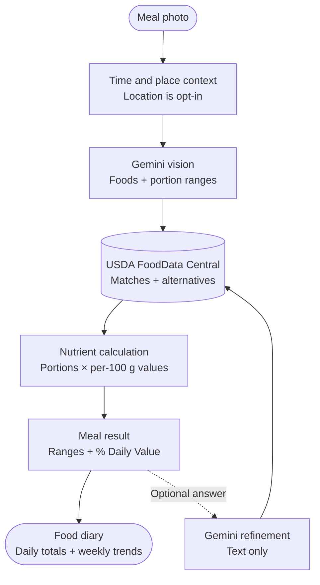

<div align="center">

# MealScholar

**Nutrition from a photo. Honest ranges, not fake precision.**

A HackUMass XIV project, piloting at UMass.

[Open the app](https://mealscholar.mannava.org) · [Visit the website](https://hackumass.mannava.org) · [Quick start](#quick-start) · [Workflow](#workflow) · [Benchmarks](BENCHMARK.md)

<sub>Python 3.12+ · FastAPI · Gemini · MongoDB Atlas</sub>

</div>

---

Snap your meal. Gemini identifies the foods and estimates their portions; a local USDA database
supplies the nutrition facts. MealScholar turns those estimates into nutrient ranges you can
inspect, correct and log.

> **The AI never invents nutrient numbers.** Nutrients come from USDA FoodData Central and
> arithmetic, not from the model.

## At a glance

| Feature | What you get |
|---|---|
| **Photo analysis** | JPEG, PNG and HEIC uploads up to 25 MB; foods and portion estimates with boxes on the photo. |
| **Honest uncertainty** | Low, likely and high values for portions and nutrients, with at most one clarifying question. |
| **Check the match** | Inspect the USDA source, search alternatives and correct the selected food. |
| **Your food diary** | Meals by day, calorie and nutrient totals, % Daily Value and weekly views. |
| **Phone-first app** | Today and Analyze tabs, camera entry points and Add to Home Screen. |
| **Campus dining APIs** | UMass Dining locations, menus, dish search, nearby halls and favorites alerts. |

Account and preference APIs are also included: registration, sessions, per-user diaries,
user-selected goals, dining preferences and favorites. The sign-in/onboarding UI is still being
completed, and emails currently queue to an outbox rather than being delivered.

**Current boundary:** dining-menu browsing is implemented, but photo-to-nutrient calculations
still use USDA only. Campus-menu nutrient matching is tracked in [TODO.md](TODO.md).

## Workflow



Loose USDA matches are suggestions, not counted foods, until a match is selected.
Choosing another USDA food recomputes the result without another photo analysis.

The pipeline is in [`pipeline.py`](src/foodsmart/pipeline.py); the shared JSON contract is
[`MealResult`](src/foodsmart/schemas.py). The model's prompt and image preparation live in
[`vision.py`](src/foodsmart/vision.py), while [`compute.py`](src/foodsmart/compute.py) handles the math.

## Quick start

Requires [uv](https://docs.astral.sh/uv/). It installs Python 3.12 if needed.
Run these commands from a clone of this repository.

**1. Install dependencies**

```sh
uv sync
```

**2. Create a local `.env`**

Get a Gemini API key from [Google AI Studio](https://aistudio.google.com/apikey), then add:

```dotenv
GEMINI_API_KEY=your-key-here
FOODSMART_AUTH_REQUIRED=0
```

`FOODSMART_AUTH_REQUIRED=0` enables a local, single-user diary without signing in.
Use it only for local development, not a shared deployment. Shell variables override `.env`,
and `.env` is gitignored.

**3. Import USDA data and start the app**

```sh
uv run foodsmart fdc-import
uv run foodsmart serve
```

Open **http://127.0.0.1:8000**. The one-time import downloads roughly 17 MB and creates
`~/.foodsmart/fdc.sqlite`. Local API documentation is at **http://127.0.0.1:8000/api/docs**.

<details>
<summary><strong>Testing from your phone</strong></summary>

```sh
uv run foodsmart serve --host 0.0.0.0
```

Open your computer's LAN address on the same Wi-Fi. Browser geolocation needs HTTPS or
`localhost`, so the location switch will not work over an ordinary LAN HTTP address.
Keep this single-user development server on a trusted network.

</details>

> **Naming:** the product is MealScholar. The package, CLI command, `FOODSMART_*` settings and
> `~/.foodsmart` data directory keep their existing names until the coordinated
> [code rename](https://github.com/hershey-harsh/HackUmass-26-MealScholar/issues/23).

## Command line

```sh
uv run foodsmart analyze lunch.jpg --json
uv run foodsmart day
uv run foodsmart week
```

<details>
<summary><strong>Analysis options, corrections and saved meals</strong></summary>

```sh
# Opt in to the photo's GPS, or supply device context.
uv run foodsmart analyze lunch.jpg --use-photo-location
uv run foodsmart analyze lunch.jpg --lat 42.39 --lon -72.53 --taken-at 2026-11-14T12:30-05:00

# Supply the clarifying answer without an interactive prompt.
uv run foodsmart analyze lunch.jpg --answer "fried in oil" --json

# Inspect meal 3 and find a different USDA match.
uv run foodsmart show 3
uv run foodsmart search "rice, white, cooked"
uv run foodsmart fix 3 1 --food 2708404

# Optional exact-weight correction for item 1 in meal 3.
uv run foodsmart fix 3 1 --grams 300
```

`--json` prints the full `MealResult`. The CLI works with the local diary; signing into the
web app keeps each account's meals separate.

</details>

## Configuration

Set these in `.env` or your shell.

| Variable | Default | Purpose |
|---|---|---|
| `GEMINI_API_KEY` | Not set | Required for photo analysis. |
| `FOODSMART_MODEL` | `gemini-4-hydrogen` | Vision model; see [model benchmarks](BENCHMARK.md). |
| `FOODSMART_THINKING` | `low` | Thinking level. Gemini 4 supports `low`, `medium`, `high`, `xhigh`; `minimal` is for 3.x Flash/Flash-Lite only. |
| `FOODSMART_HOME` | `~/.foodsmart` | USDA database, downloads and SQLite diary. |
| `FOODSMART_NOMINATIM_URL` | Public OpenStreetMap Nominatim | Place lookup; the public service allows 1 request/second. |

<details>
<summary><strong>Accounts, dining data and deployment settings</strong></summary>

| Variable | Default | Purpose |
|---|---|---|
| `MONGODB_URI` | Not set | Persistent accounts/preferences and access to dining data. Without it, accounts/preferences are in memory and dining routes return 503. |
| `FOODSMART_MONGODB_DB` | `mealscholar` | Accounts and preferences database. |
| `FOODSMART_DINING_DB` | `umass_dining` | Read-only dining-menu database. |
| `FOODSMART_AUTH_REQUIRED` | `1` | Require sign-in for meal and diary routes. |
| `FOODSMART_PUBLIC_URL` | `http://127.0.0.1:8000` | Public origin for account links and cross-site checks. |
| `FOODSMART_COOKIE_SECURE` | `1` | HTTPS-only session cookies. Set to `0` only when testing accounts over local HTTP. |
| `FOODSMART_EMAIL_PROVIDER` | `outbox` | Queue account emails; SMTP delivery is not implemented yet. |
| `FOODSMART_DEMO_VERIFY_LINK` | `0` | Demo-only verification links in responses; never enable publicly. |
| `FOODSMART_DEV_OUTBOX` | `0` | Development-only outbox endpoint; never enable publicly. |

Do not deploy with in-memory accounts or expose the development outbox. Email delivery must be
configured and implemented before relying on password-reset emails.

</details>

## Rules the code enforces

- **Data, not guesses:** the model estimates foods and grams; USDA data supplies the nutrients.
- **Ranges stay visible:** photo-based amounts have low/likely/high estimates. Exact-weight
  corrections through the CLI or API can collapse a range.
- **Private by default:** location is opt-in; coordinates and photos are not stored in the diary.
  Images sent to Gemini are re-encoded without EXIF, using `store=False`.
- **Estimates, not diagnosis:** micronutrients are labelled as estimates; weekly averages count
  only days with logged meals.
- **Your goals, not prescriptions:** calorie goals are optional and user-selected. % Daily Value
  is a label reference, not a prescribed goal. No insulin or carb-dosing advice.

## Sites and deployment

| Site | Address | Source |
|---|---|---|
| **App** | [mealscholar.mannava.org](https://mealscholar.mannava.org) | [`src/foodsmart/site/`](src/foodsmart/site/) + [`web.py`](src/foodsmart/web.py) |
| **Landing page** | [hackumass.mannava.org](https://hackumass.mannava.org) | [`web/`](web/) |

Both sites deploy on pushes to `main` through
[`deploy-site.yml`](.github/workflows/deploy-site.yml) on Harsh's Mac mini. Both frontends use
plain HTML/CSS/JavaScript, with no build step. Coordinate deploy changes through the team board
as described in [AGENTS.md](AGENTS.md).

## Development

```sh
uvx ruff@0.17.5 check
uvx ruff@0.17.5 format --check
uv run pytest

# Replay recorded Gemini output through the USDA lookup without API calls.
uv run python bench/report.py --rematch
```

Use `uvx ruff@0.17.5 format` to apply formatting.

CI: [Lint and formatting](https://github.com/hershey-harsh/HackUmass-26-MealScholar/actions/workflows/lint.yml) · [USDA lookup regression](https://github.com/hershey-harsh/HackUmass-26-MealScholar/actions/workflows/lookup-regression.yml)

- [Benchmarks](BENCHMARK.md) — model comparisons, latency, cost and lookup findings.
- [Team TODO](TODO.md) — remaining work and known limitations.
- [Submission draft](submissions/devpost.md) — project story and judging notes.
- [Film plan](video/film-plan.md) — demo-video shots and production schedule.

## Data sources

- **Nutrition:** [USDA FoodData Central](https://fdc.nal.usda.gov/) — Survey/FNDDS, Foundation
  and SR Legacy data, CC0.
- **Places:** [OpenStreetMap contributors](https://www.openstreetmap.org/copyright), ODbL,
  via Nominatim.
- **Campus menus:** UMass Dining data in MongoDB Atlas, currently used by the dining APIs,
  not by the photo nutrient calculation.
